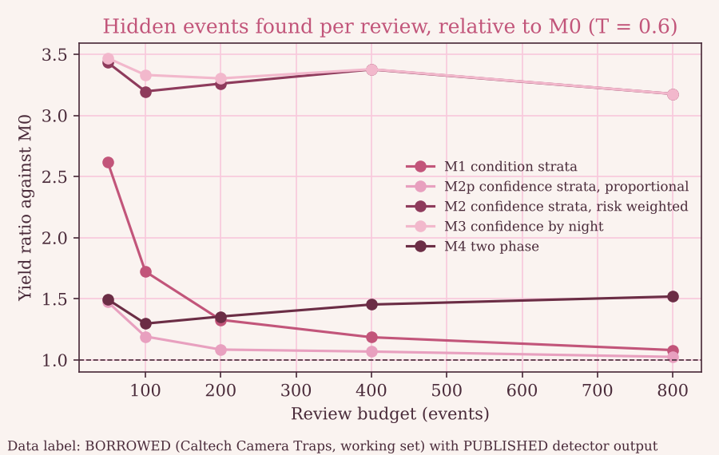
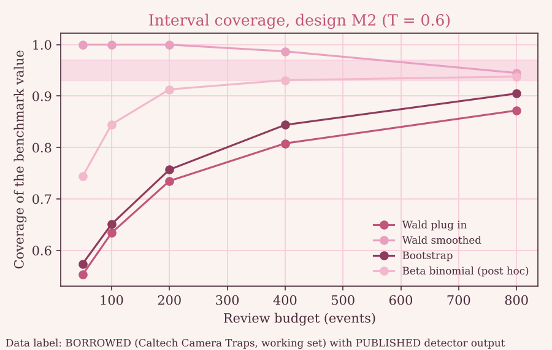

<!-- generated by scripts/make_docs.py. Do not edit by hand. -->

# SCOPE AUDIT 🌷

A free, reproducible audit of what an animal detector hides in the images it calls empty, for camera trap programmes. Built for the TDRA UAE Hackathon 2026, Challenge 34 (Ministry of Climate Change and Environment, AI powered wildlife monitoring).

Author: Huda Mueen (Team IZZA).

## What it does 🌸

- Draws a seeded, documented review sample from the events the detector called negative.
- Estimates the false omission rate of that pool with an interval, and handles unresolved reviews with bounds.
- Keeps an append only, hash chained review log from machine suggestion to approved record.
- Exports only human approved observations as a Camtrap DP 1.0.2 package with a separate audit package.

It makes no statement about how many animals exist, where a species lives, or whether a species is gone.

## Headline results (BORROWED benchmark, PUBLISHED detector output) 🍋

- At threshold 0.2 the event level false omission rate on the full benchmark is 1.41 percent, and the image level rate is 8.79 percent.
- In the stress regime (threshold 0.6) the confidence strata design M2 found 3.20, 3.26 and 3.38 times the hidden events per review of simple random sampling at budgets of 100, 200 and 400.
- Predictions held: 5 of 8. Missed: P3, P6, P7. Details in results/RESULTS.md.

The detector saw this benchmark during training, so absolute error rates are likely optimistic. No data from the United Arab Emirates were used. See docs/LIMITATIONS.md and docs/DATA_LABELS.md.



Figure 1. Hidden events found per review relative to simple random sampling. Data label: BORROWED with PUBLISHED detector output.



Figure 2. Interval coverage by budget for design M2. Data label: BORROWED with PUBLISHED detector output. The shaded band is the 93 to 97 percent target, which no interval met everywhere.

## Run it 🌿

```
pip install -r requirements.txt
python -m pytest -q
streamlit run app/streamlit_app.py
python -m scopeaudit.cli audit --threshold 0.2 --budget 200 --method M2
python scripts/make_docs.py
```

## Layout

- scopeaudit: engine (estimators, sampling, strata, audit, review log, export, privacy, integrity).
- app: the three screen demo. experiments: experiments A, B and C. scripts: data, evaluation and documentation.
- docs: method, decisions, predictions, prior art, limitations, pilot plan, pitch and red team.
- results and figures: generated outputs, each labelled.

## Licence

MIT. Data licences and attribution are in data/demo/ATTRIBUTION.md.
