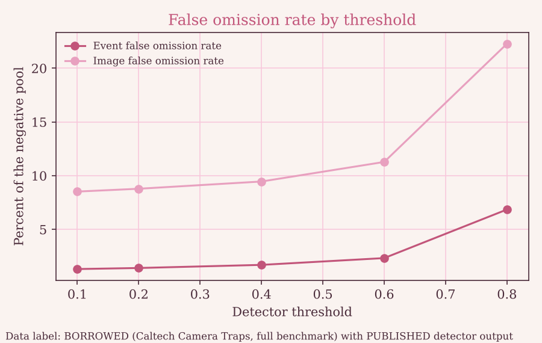
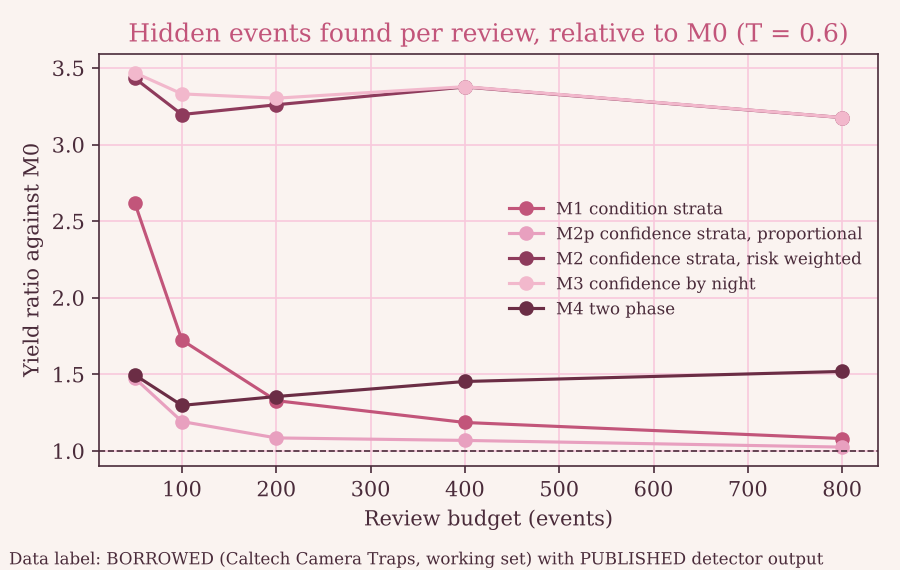
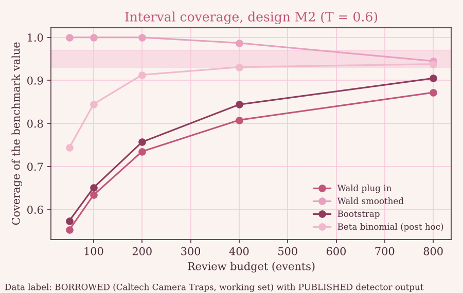
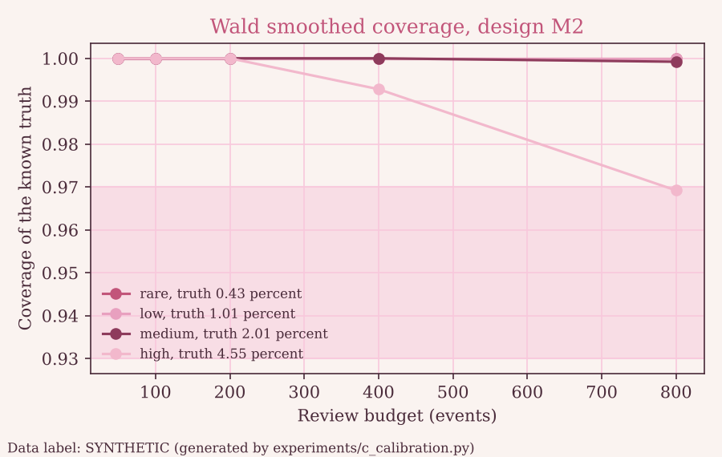

Superiority claim status: supported on the BORROWED benchmark. Prediction P2 held: design M2 found 3.26 times as many hidden animal events per 100 reviews as simple random sampling at a budget of 200 (stress threshold 0.6). This says nothing about the United Arab Emirates.

<!-- generated by scripts/make_docs.py. Do not edit by hand. -->

# Results

Every section names its data label. BORROWED means Caltech Camera Traps images and labels. PUBLISHED means detector output released by the detector authors. SYNTHETIC means generated by code in this repository (see docs/DATA_LABELS.md).

## Environment

Python 3.13.18, 2 CPUs, device cpu, threads OMP_NUM_THREADS=1, OPENBLAS_NUM_THREADS=1, MKL_NUM_THREADS=1. Predictions committed in 57935c3e5e before any experiment. Seeds: 1000 for experiment B and 5000 for experiment C.

## Scorecard (BORROWED and SYNTHETIC, see each row)

| Item | Statement | Outcome |
|---|---|---|
| P1 | Event level FOR below 3 percent at T of 0.2 (full benchmark, experiment A). | held |
| P2 | In the stress regime, M2 yield per 100 reviews is at least 1.5 times M0 at budgets 100 to 400. | held |
| P3 | M1 yield is below 1.3 times M0 (budgets 100 to 400) and the ratio interval includes 1.0 for at least one budget. | MISSED |
| P4 | M3 yield is within 10 percent of M2 (stress regime, budgets 100 to 400). | held |
| P5 | M2 mean error within 0.25 percentage points at budgets of 200 or more (stress regime). | held |
| P6 | Wald plug in undercovers (below 93 percent) somewhere; smoothed or bootstrap intervals reach 93 to 97 percent at budgets 400 or more (M2, stress regime). | MISSED |
| P7 | Wilson with finite population correction covers 93 to 97 percent at budgets of 200 or more when FOR is at least 1 percent. | MISSED |
| P8 | Identical inputs, configuration and seed give identical sample identifiers in 100 percent of runs. | held |
| S1 | P2 holds. | held |
| S2 | The recommended estimator covers 93 to 97 percent (read as: a P6 named interval, M2, stress regime, budgets 400 and 800). | MISSED |
| S3 | P5 holds. | held |
| S4 | P8 holds. | held |
| S5 | The claims lint passes. | held |

## Experiment A. Detector error on the full benchmark (BORROWED images, PUBLISHED detector output)

181,008 events and 243,100 frames. Share of events with an animal: 30.5 percent. Percent columns are percent. Event level is the unit of analysis.

| Threshold | Negative pool share (percent) | Hidden animal events | Event FOR (percent) | Event recall (percent) | Image FOR (percent) | Locations with hidden events | Share of hidden events in 10 locations (percent) |
|---|---|---|---|---|---|---|---|
| 0.1 | 61.5 | 1463 | 1.31 | 97.35 | 8.52 | 113 | 47.6 |
| 0.2 | 65.5 | 1675 | 1.41 | 96.96 | 8.79 | 120 | 45.4 |
| 0.4 | 68.6 | 2115 | 1.70 | 96.16 | 9.46 | 124 | 42.5 |
| 0.6 | 70.3 | 2970 | 2.34 | 94.61 | 11.28 | 127 | 41.2 |
| 0.8 | 74.3 | 9213 | 6.85 | 83.29 | 22.28 | 132 | 41.2 |

Figure 1. Event and image false omission rate by threshold. Data label: BORROWED with PUBLISHED detector output. The detector saw this benchmark in training, so these rates are likely optimistic.

## Experiment B. Comparison of sampling designs (BORROWED, working set of 8,000 events)

Regimes: 0.1, 0.2, 0.4, 0.6, 0.8. Stress regime: threshold 0.6, pool 5,628 events, benchmark rate in the pool 2.47 percent, 139 hidden events. Headline regime: threshold 0.2, rate 1.57 percent.

### Yield ratio against M0, stress regime (BORROWED)

| Design | n = 50 | n = 100 | n = 200 | n = 400 | n = 800 |
|---|---|---|---|---|---|
| M1 condition strata | 2.62 (2.47 to 2.78) | 1.72 (1.65 to 1.80) | 1.33 (1.28 to 1.37) | 1.19 (1.16 to 1.22) | 1.08 (1.06 to 1.10) |
| M2p confidence strata, proportional | 1.47 (1.38 to 1.58) | 1.19 (1.13 to 1.25) | 1.08 (1.05 to 1.12) | 1.07 (1.04 to 1.10) | 1.02 (1.01 to 1.04) |
| M2 confidence strata, risk weighted | 3.43 (3.23 to 3.65) | 3.20 (3.06 to 3.33) | 3.26 (3.16 to 3.36) | 3.38 (3.31 to 3.44) | 3.18 (3.13 to 3.22) |
| M3 confidence by night | 3.47 (3.26 to 3.69) | 3.33 (3.20 to 3.47) | 3.30 (3.21 to 3.40) | 3.38 (3.31 to 3.45) | 3.18 (3.13 to 3.22) |
| M4 two phase | 1.50 (1.39 to 1.60) | 1.30 (1.23 to 1.36) | 1.35 (1.31 to 1.40) | 1.45 (1.42 to 1.49) | 1.52 (1.49 to 1.54) |

Figure 2. Hidden events found per review relative to simple random sampling. Data label: BORROWED with PUBLISHED detector output. Interval from a bootstrap over seeds.

### Yield ratio against M0, headline regime (BORROWED)

| Design | n = 50 | n = 100 | n = 200 | n = 400 | n = 800 |
|---|---|---|---|---|---|
| M1 condition strata | 3.74 | 2.24 | 1.60 | 1.29 | 1.13 |
| M2p confidence strata, proportional | 1.15 | 1.05 | 1.00 | 1.01 | 1.00 |
| M2 confidence strata, risk weighted | 1.39 | 1.37 | 1.32 | 1.33 | 1.33 |
| M3 confidence by night | 1.58 | 1.44 | 1.42 | 1.35 | 1.35 |
| M4 two phase | 1.09 | 1.08 | 1.05 | 1.10 | 1.08 |

### Bias and interval coverage, design M2, stress regime (BORROWED)

| Budget | Bias (percentage points) | Wald plug in | Wald smoothed | Bootstrap | Beta binomial (post hoc) |
|---|---|---|---|---|---|
| 50 | 0.002 | 55.3 | 100.0 | 57.4 | 74.4 |
| 100 | -0.027 | 63.4 | 100.0 | 65.1 | 84.5 |
| 200 | -0.037 | 73.5 | 100.0 | 75.7 | 91.3 |
| 400 | -0.012 | 80.8 | 98.7 | 84.4 | 93.1 |
| 800 | 0.027 | 87.2 | 94.5 | 90.5 | 93.8 |

Coverage columns are percent of audits whose interval contained the benchmark value. Target 93 to 97.

Figure 3. Coverage by budget for design M2. Data label: BORROWED with PUBLISHED detector output. The shaded band is the target.

### Simple random sample, Wilson interval with finite population correction (BORROWED)

| Regime | Benchmark rate (percent) | n = 200 | n = 400 | n = 800 |
|---|---|---|---|---|
| 0.1 | 1.48 | 96.7 | 94.8 | 94.2 |
| 0.2 | 1.57 | 95.6 | 94.5 | 93.5 |
| 0.4 | 1.73 | 98.0 | 94.2 | 95.0 |
| 0.6 | 2.47 | 96.4 | 93.1 | 94.9 |
| 0.8 | 6.97 | 92.7 | 93.8 | 94.9 |

Coverage in percent.

### Unresolved reviews, design M2, stress regime (BORROWED)

| Budget | Unresolved share (percent) | Share of audits whose outer interval contains the benchmark value (percent) | Mean lower bound (percent) | Mean upper bound (percent) |
|---|---|---|---|---|
| 50 | 0 | 100.0 | 2.47 | 2.47 |
| 50 | 5 | 100.0 | 2.36 | 7.07 |
| 50 | 10 | 100.0 | 2.22 | 12.05 |
| 100 | 0 | 100.0 | 2.44 | 2.44 |
| 100 | 5 | 100.0 | 2.32 | 7.54 |
| 100 | 10 | 100.0 | 2.22 | 12.36 |
| 200 | 0 | 100.0 | 2.43 | 2.43 |
| 200 | 5 | 100.0 | 2.31 | 7.42 |
| 200 | 10 | 100.0 | 2.19 | 12.34 |
| 400 | 0 | 98.7 | 2.46 | 2.46 |
| 400 | 5 | 100.0 | 2.34 | 7.28 |
| 400 | 10 | 100.0 | 2.21 | 12.28 |
| 800 | 0 | 94.5 | 2.50 | 2.50 |
| 800 | 5 | 99.7 | 2.37 | 7.38 |
| 800 | 10 | 99.8 | 2.25 | 12.29 |

## Experiment C. Calibration on synthetic pools with known truth (SYNTHETIC)

All pools in this section are SYNTHETIC. Coverage in percent.

| Scenario | Truth (percent) | Budget | M2 Wald plug in | M2 Wald smoothed | M2 Bootstrap | M2 Beta binomial (post hoc) | M0 Wilson |
|---|---|---|---|---|---|---|---|
| rare | 0.43 | 200 | 84.6 | 100.0 | 84.4 | 56.7 | 93.7 |
| rare | 0.43 | 400 | 85.0 | 100.0 | 88.2 | 73.7 | 97.7 |
| rare | 0.43 | 800 | 86.5 | 100.0 | 94.4 | 84.3 | 95.4 |
| low | 1.01 | 200 | 81.8 | 100.0 | 87.5 | 76.6 | 94.6 |
| low | 1.01 | 400 | 85.9 | 100.0 | 90.1 | 85.1 | 93.3 |
| low | 1.01 | 800 | 85.0 | 100.0 | 91.3 | 90.3 | 96.3 |
| medium | 2.01 | 200 | 89.6 | 100.0 | 91.5 | 80.8 | 93.9 |
| medium | 2.01 | 400 | 91.1 | 100.0 | 93.8 | 86.0 | 95.7 |
| medium | 2.01 | 800 | 92.1 | 99.9 | 96.4 | 90.7 | 95.4 |
| high | 4.55 | 200 | 89.7 | 100.0 | 91.3 | 88.7 | 94.6 |
| high | 4.55 | 400 | 90.3 | 99.3 | 92.4 | 92.4 | 95.4 |
| high | 4.55 | 800 | 89.4 | 96.9 | 93.3 | 93.9 | 95.3 |

Figure 4. Wald smoothed coverage of design M2 on synthetic pools. Data label: SYNTHETIC. The shaded band is the target.

Reproducibility: 1000 of 1000 repeated draws gave identical sample identifiers (SYNTHETIC).

## Reading the misses (generated from the scorecard)

- P3 missed. M1 yield is below 1.3 times M0 (budgets 100 to 400) and the ratio interval includes 1.0 for at least one budget. Observed: M1 to M0 yield ratio by budget: 100: 1.72 (1.65 to 1.80), 200: 1.33 (1.28 to 1.37), 400: 1.19 (1.16 to 1.22).
- P6 missed. Wald plug in undercovers (below 93 percent) somewhere; smoothed or bootstrap intervals reach 93 to 97 percent at budgets 400 or more (M2, stress regime). Observed: first clause held, second clause missed; smoothed and bootstrap coverage for M2 (percent): n = 400: 98.7 and 84.4, n = 800: 94.5 and 90.5.
- P7 missed. Wilson with finite population correction covers 93 to 97 percent at budgets of 200 or more when FOR is at least 1 percent. Observed: 24 cells, coverage from 92.7 to 98.0 percent; outside the band: B T=0.4 budget 200 98.0; B T=0.8 budget 200 92.7.

Stratified cells at budgets of 200 or more (BORROWED regimes and SYNTHETIC scenarios together). Counts of cells below 93 percent and above 97 percent coverage:

| Interval | Cells | Below 93 percent | Above 97 percent |
|---|---|---|---|
| Wald plug in | 135 | 115 | 0 |
| Wald smoothed | 135 | 3 | 66 |
| Bootstrap | 135 | 78 | 0 |
| Beta binomial (post hoc) | 135 | 94 | 0 |

The plug in Wald interval undercovered in 205 of 225 stratified cells over all budgets. No interval met the 93 to 97 percent target in every setting, so interval claims in this repository are limited to the coverage tables above.

Runtime: experiment B 186.7 seconds, experiment C 742.4 seconds.
